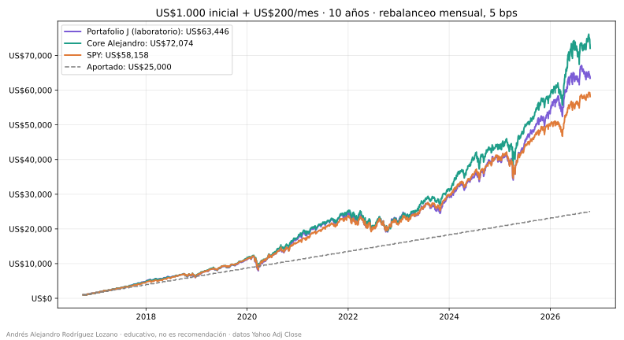
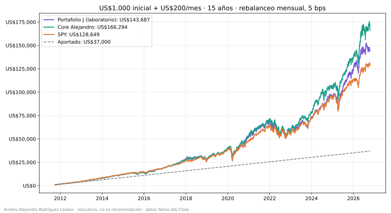
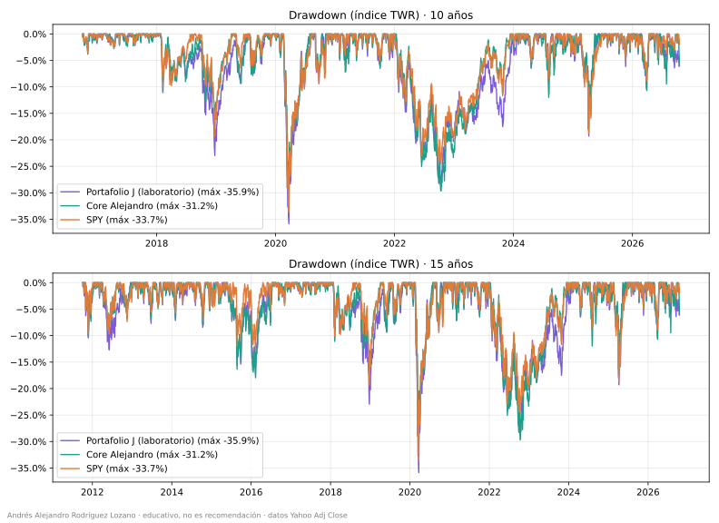
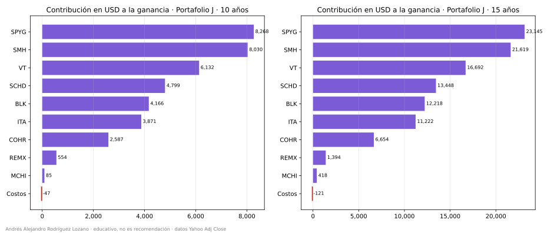
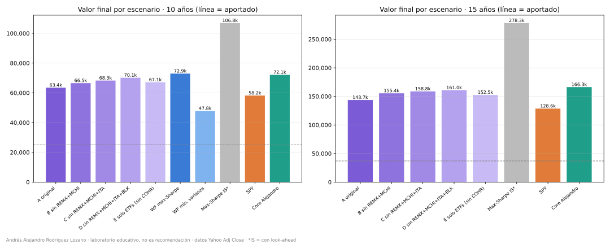
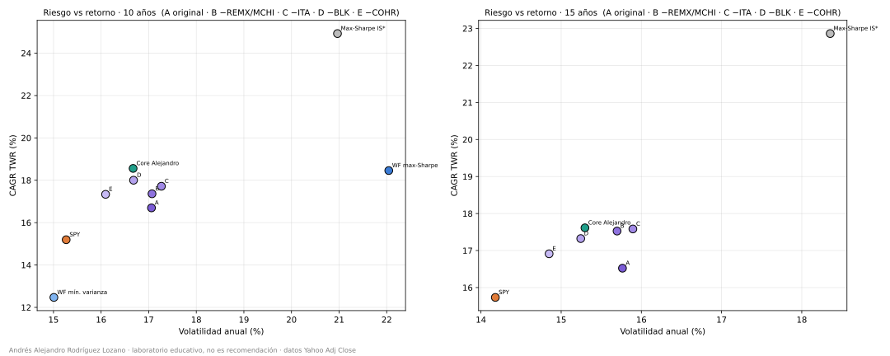
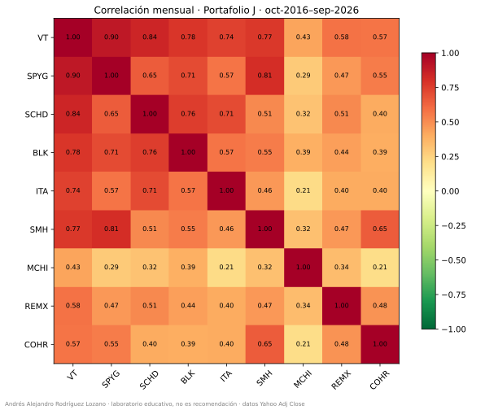
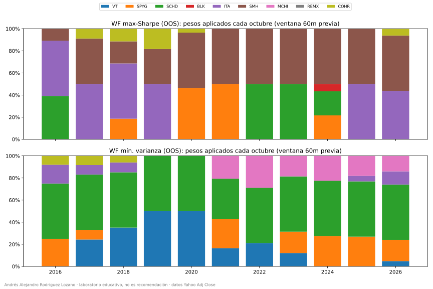

# Laboratorio: backtest del Portafolio J

**Autor:** Andrés Alejandro Rodríguez Lozano · Octubre 2026
> 🧪 **Laboratorio, no recomendación.** Material **educativo**; no es asesoría de inversión. Los tickers están por fuera de la tesis del core: esto no es un candidato a mezcla.

## Escenario
- Portafolio (captura eToro 18-oct-2026, % por valor, normalizado): VT 20,81 · SPYG 20,82 · SCHD 15,01 · BLK 12,81 · ITA 12,00 · SMH 9,55 · REMX 3,44 · MCHI 3,04 · COHR 2,53.
- Flujo: US$1.000 el primer día hábil de oct-2016 / oct-2011 + US$200 el primer día hábil de cada mes siguiente hasta oct-2026 (120 / 180 aportes). Valoración: cierre del 16-oct-2026.
- Rebalanceo mensual en el día del aporte; costo 5 bps sobre nocional negociado (compras + ventas); sensibilidad 0 / 5 / 15 bps.
- Benchmarks con el mismo flujo: **SPY** y **core de Alejandro** (SPYG 30,51 · SMH 21,76 · BRK.B 20,40 · IEMG 20,15 · VTI 7,18).
- Datos: Yahoo Adjusted Close vía `yfinance`; `src/data.py` descarga y guarda una caché local en `data/precios.parquet` (no se versiona).
- Historia incompleta (método sensibilidad): antes del primer precio se usa el retorno diario real de SPY. SCHD: 14 sesiones (3 al 20-oct-2011). IEMG (core): 3-oct-2011 a 24-oct-2012. La ventana de 10 años es 100% dato real.

## Resultados (5 bps)
| Métrica | Portafolio J 10a | Core 10a | SPY 10a | Portafolio J 15a | Core 15a | SPY 15a |
|---|---:|---:|---:|---:|---:|---:|
| Aportado | 25.000 | 25.000 | 25.000 | 37.000 | 37.000 | 37.000 |
| Valor final | 63.446 | 72.074 | 58.158 | 143.687 | 166.294 | 128.649 |
| CAGR TWR | 16,70% | 18,56% | 15,19% | 16,52% | 17,61% | 15,73% |
| XIRR | 17,13% | 19,40% | 15,57% | 16,06% | 17,68% | 14,82% |
| Volatilidad | 17,06% | 16,67% | 15,27% | 15,76% | 15,30% | 14,18% |
| Sharpe rf=4% | 0,76 | 0,87 | 0,75 | 0,80 | 0,88 | 0,83 |
| Max DD | −35,9% | −31,2% | −33,7% | −35,9% | −31,2% | −33,7% |
| Calmar | 0,47 | 0,59 | 0,45 | 0,46 | 0,56 | 0,47 |






Tablas completas en `output/metricas_10a.csv`, `output/metricas_15a.csv`, `output/contribucion_*.csv`, `output/sensibilidad_costos.csv`.

## Estructura
```
src/config.py     pesos, horizontes, costos
src/data.py       descarga yfinance + caché parquet
src/backtest.py   motor diario: aportes, rebalanceo, costos, TWR
src/metrics.py    CAGR, XIRR, Sharpe, Sortino, DD, Calmar, Ulcer, bajo agua, TE, contribución
src/validate.py   asserts (NaN, pesos, rangos, meses, aportes, look-ahead, contabilidad)
src/plots.py      gráficos con nombres estables
src/pipeline.py   orquestación
run_backtest.py   corre todo y guarda CSV/PNG
notebooks/backtest_portafolio_j.ipynb       clase paso a paso (11 capítulos)
notebooks/apendice_optimizacion.ipynb  apéndice: ¿simplificar el portafolio? (9 capítulos)
src/optim.py      escenarios de corte, redundancia, optimizador walk-forward
src/lab_optim.py  orquesta el apéndice (python -m src.lab_optim)
output/           figuras (.svg) y CSV del backtest principal
output/optimizacion/  figuras (.svg) y CSV del apéndice
```

## Cómo correrlo
```bash
pip install -r requirements.txt
python run_backtest.py
python -m src.lab_optim
jupyter nbconvert --to notebook --execute --inplace notebooks/backtest_portafolio_j.ipynb
jupyter nbconvert --to notebook --execute --inplace notebooks/apendice_optimizacion.ipynb
```

## Limitaciones
Pesos actuales aplicados hacia atrás (sesgo de retrospectiva); sin impuestos, spreads de eToro, conversión COP/USD ni retención de dividendos; COHR en Yahoo es la serie continua de II-VI. El pasado no garantiza el futuro.

---

## Apéndice: ¿simplificar el portafolio?
> 🧪 **Laboratorio, no recomendación.** Notebook: [`notebooks/apendice_optimizacion.ipynb`](notebooks/apendice_optimizacion.ipynb).

**Hipótesis:** cortar activos "redundantes" (ITA, BLK, REMX, MCHI) mejora la rentabilidad sin empeorar el riesgo. Mismo flujo (US$1.000 + US$200/mes), rebalanceo mensual, 5 bps.

**Escenarios predeclarados** (el peso cortado se reparte proporcionalmente entre los que quedan, tope 50%): A original · B sin REMX+MCHI · C sin REMX+MCHI+ITA · D sin REMX+MCHI+ITA+BLK (VT, SPYG, SCHD, SMH, COHR) · E solo ETFs (VT, SPYG, SCHD, SMH).

### 10 años (oct-2016–oct-2026, aportado US$25.000)
| Escenario | # activos | Valor final | XIRR | CAGR TWR | Vol | Sharpe rf=4% | Max DD | Calmar | 2022 ret |
|---|---:|---:|---:|---:|---:|---:|---:|---:|---:|
| A original | 9 | 63.446 | 17,1% | 16,7% | 17,1% | 0,76 | -35,9% | 0,47 | -18,1% |
| B sin REMX+MCHI | 7 | 66.492 | 18,0% | 17,4% | 17,1% | 0,79 | -36,2% | 0,48 | -17,7% |
| C sin REMX+MCHI+ITA | 6 | 68.251 | 18,4% | 17,7% | 17,3% | 0,80 | -33,9% | 0,52 | -21,4% |
| D sin REMX+MCHI+ITA+BLK | 5 | 70.116 | 18,9% | 18,0% | 16,7% | 0,84 | -32,3% | 0,56 | -21,9% |
| E solo ETFs (sin COHR) | 4 | 67.073 | 18,1% | 17,3% | 16,1% | 0,83 | -32,5% | 0,53 | -20,8% |
| WF max-Sharpe (OOS) | 2–4 | 72.899 | 19,6% | 18,5% | 22,0% | 0,70 | -41,2% | 0,45 | -26,7% |
| WF mín. varianza (OOS) | 2–5 | 47.828 | 12,0% | 12,5% | 15,0% | 0,60 | -33,7% | 0,37 | -13,4% |
| Max-Sharpe in-sample (optimista, con look-ahead) | 4 | 106.835 | 26,4% | 24,9% | 21,0% | 0,98 | -35,2% | 0,71 | -25,4% |
| SPY | 1 | 58.158 | 15,6% | 15,2% | 15,3% | 0,75 | -33,7% | 0,45 | -18,2% |
| Core Alejandro | 5 | 72.074 | 19,4% | 18,6% | 16,7% | 0,87 | -31,2% | 0,59 | -21,3% |

### 15 años (oct-2011–oct-2026, aportado US$37.000)
| Escenario | # activos | Valor final | XIRR | CAGR TWR | Vol | Sharpe rf=4% | Max DD | Calmar | 2022 ret |
|---|---:|---:|---:|---:|---:|---:|---:|---:|---:|
| A original | 9 | 143.687 | 16,1% | 16,5% | 15,8% | 0,80 | -35,9% | 0,46 | -18,1% |
| B sin REMX+MCHI | 7 | 155.426 | 16,9% | 17,5% | 15,7% | 0,86 | -36,2% | 0,48 | -17,7% |
| C sin REMX+MCHI+ITA | 6 | 158.763 | 17,2% | 17,6% | 15,9% | 0,85 | -33,9% | 0,52 | -21,4% |
| D sin REMX+MCHI+ITA+BLK | 5 | 160.958 | 17,3% | 17,3% | 15,2% | 0,87 | -32,3% | 0,54 | -21,9% |
| E solo ETFs (sin COHR) | 4 | 152.534 | 16,7% | 16,9% | 14,8% | 0,86 | -32,5% | 0,52 | -20,7% |
| Max-Sharpe in-sample (optimista, con look-ahead) | 4 | 278.265 | 23,4% | 22,9% | 18,4% | 1,00 | -34,8% | 0,66 | -20,3% |
| SPY | 1 | 128.649 | 14,8% | 15,7% | 14,2% | 0,83 | -33,7% | 0,47 | -18,2% |
| Core Alejandro | 5 | 166.294 | 17,7% | 17,6% | 15,3% | 0,88 | -31,2% | 0,56 | -21,3% |

No hay walk-forward a 15 años: requeriría historia de SCHD anterior a 2011 y no se inventan series.




### ¿Se sostiene en dos subventanas?
| Escenario | 2016–2021 valor · XIRR · Max DD | 2021–2026 valor · XIRR · Max DD |
|---|---|---|
| A original | 21.581 · 19,8% · -35,9% | 22.008 · 19,9% · -28,8% |
| B sin REMX+MCHI | 21.542 · 19,7% · -36,2% | 22.775 · 21,2% · -28,8% |
| C sin REMX+MCHI+ITA | 22.530 · 21,4% · -33,9% | 22.924 · 21,4% · -31,2% |
| D sin REMX+MCHI+ITA+BLK | 22.153 · 20,8% · -32,3% | 23.555 · 22,5% · -29,6% |
| E solo ETFs (sin COHR) | 22.056 · 20,6% · -32,5% | 22.654 · 21,0% · -28,4% |
| SPY | 20.593 · 18,0% · -33,7% | 20.500 · 17,1% · -24,5% |
| Core Alejandro | 21.846 · 20,2% · -31,2% | 23.974 · 23,2% · -29,7% |

### Redundancia (oct-2016–sep-2026, portafolio original)
| Activo | Peso | Vol anual | Contrib. riesgo | Riesgo/Peso | R² vs los demás | Corr con VT |
|---|---:|---:|---:|---:|---:|---:|
| VT | 20,8% | 14,8% | 17,6% | 0,84 | 0,95 | 1,00 |
| SPYG | 20,8% | 17,4% | 19,1% | 0,92 | 0,89 | 0,90 |
| SCHD | 15,0% | 15,3% | 11,3% | 0,75 | 0,81 | 0,84 |
| BLK | 12,8% | 25,5% | 16,0% | 1,25 | 0,67 | 0,78 |
| ITA | 12,0% | 21,7% | 11,5% | 0,96 | 0,63 | 0,74 |
| SMH | 9,5% | 28,9% | 13,2% | 1,38 | 0,74 | 0,77 |
| MCHI | 3,0% | 24,3% | 1,8% | 0,60 | 0,35 | 0,43 |
| REMX | 3,4% | 39,1% | 4,9% | 1,42 | 0,41 | 0,58 |
| COHR | 2,5% | 49,9% | 4,7% | 1,85 | 0,47 | 0,57 |

| Métrica | A original | D | E |
|---|---:|---:|---:|
| Vol portafolio | 0,17 | 0,17 | 0,16 |
| Ratio diversificación (Σwσ/σp) | 1,23 | 1,13 | 1,10 |
| N efectivo por pesos (1/Σw²) | 6,59 | 3,97 | 3,70 |
| N efectivo por riesgo (1/Σrc²) | 7,09 | 4,34 | 3,81 |



### Walk-forward sin look-ahead
Cada octubre se estiman pesos con los 60 meses cerrados previos (el primero usa 59: nov-2011–sep-2016) y se aplican fuera de muestra (oct-2016–oct-2026). Long-only, 2% ≤ peso ≤ 50% si se incluye, universo = los 9 activos.

**Max-Sharpe (rf 4%)**

| Octubre | VT | SPYG | SCHD | BLK | ITA | SMH | MCHI | REMX | COHR |
|---|---:|---:|---:|---:|---:|---:|---:|---:|---:|
| 2016 |  |  | 39% |  | 50% | 11% |  |  |  |
| 2017 |  |  |  |  | 50% | 41% |  |  | 9% |
| 2018 |  | 19% |  |  | 50% | 20% |  |  | 11% |
| 2019 |  |  |  |  | 50% | 32% |  |  | 18% |
| 2020 |  | 46% |  |  |  | 50% |  |  | 4% |
| 2021 |  | 50% |  |  |  | 50% |  |  |  |
| 2022 |  |  | 50% |  |  | 50% |  |  |  |
| 2023 |  |  | 50% |  |  | 50% |  |  |  |
| 2024 |  | 22% | 22% | 7% |  | 50% |  |  |  |
| 2025 |  |  |  |  | 50% | 50% |  |  |  |
| 2026 |  |  |  |  | 44% | 50% |  |  | 6% |

**Mínima varianza**

| Octubre | VT | SPYG | SCHD | BLK | ITA | SMH | MCHI | REMX | COHR |
|---|---:|---:|---:|---:|---:|---:|---:|---:|---:|
| 2016 |  | 25% | 50% |  | 17% |  |  |  | 8% |
| 2017 | 24% | 9% | 50% |  | 9% |  |  |  | 8% |
| 2018 | 35% |  | 50% |  | 9% |  |  |  | 6% |
| 2019 | 50% |  | 50% |  |  |  |  |  |  |
| 2020 | 50% |  | 50% |  |  |  |  |  |  |
| 2021 | 16% | 27% | 36% |  |  |  | 21% |  |  |
| 2022 | 21% |  | 50% |  |  |  | 29% |  |  |
| 2023 | 12% | 19% | 50% |  |  |  | 19% |  |  |
| 2024 |  | 28% | 50% |  |  |  | 22% |  |  |
| 2025 |  | 27% | 50% |  | 5% |  | 18% |  |  |
| 2026 | 5% | 19% | 50% |  | 12% |  | 14% |  |  |



El **max-Sharpe in-sample** (optimizado conociendo todo el periodo) se reporta solo como techo *optimista, con look-ahead*.

### Conclusión honesta
1. **La hipótesis es débil en su forma fuerte.** D mejora valor final y caída máxima (−35,9% → −32,3%), pero **pierde defensa en 2022** (−21,9% vs −18,1%) y **diversificación** (apuestas efectivas por riesgo 7,1 → 4,3); en 2021–2026 su caída máxima es algo peor que la del original.
2. **Los cortes se eligieron ex post:** se quitaron activos que hoy sabemos que rindieron poco. Quitar COHR (un ganador ex post) en E reduce el valor final.
3. **Los redundantes no eran los cortados:** el más redundante es VT (R² 0,95); MCHI y REMX eran los más descorrelacionados.
4. **El walk-forward no agrega valor ajustado por riesgo:** el max-Sharpe es inestable, concentrado y con peor Sharpe y caída (−41%) que el original; la mínima varianza termina con el menor valor.

*Andrés Alejandro Rodríguez Lozano · laboratorio, no recomendación*
